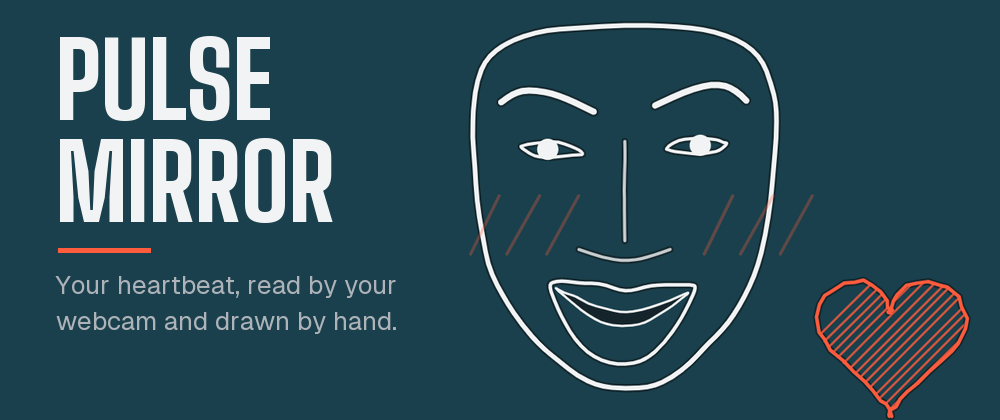
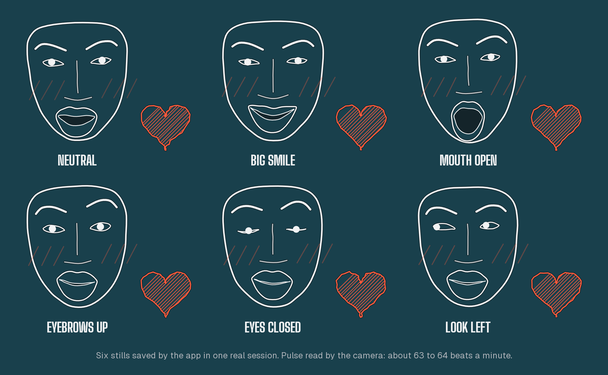

# Pulse Mirror



A mirror that shows your heartbeat in your own face.

Pulse Mirror reads your pulse from your laptop camera using the [Presage SmartSpectra SDK](https://smartspectra.presagetech.com/docs), then makes your reflection flush with each beat and swell with each breath. Capture a short clip (6 seconds by default, up to 30) of a hand-drawn portrait of you with a heart that beats at your rhythm, and save it to share.

It is a desktop app (Electron, Windows x64). Everything you see is drawn from the SDK's live readings. Nothing is simulated.

> Demo video: _to be added before submission_

## What happens on screen

1. **Consent.** A plain card says what the camera does and does not do. Nothing starts until you press Start camera.
2. **Finding.** Your live face sits under an old film-leader countdown (crosshair, rings, a sweeping arm, an outline number counting seconds). Face dots show the app can see you while it looks for your pulse.
3. **Locked.** Once the SDK reports a stable pulse, the leader falls away. Your whole face flushes in time with your pulse waveform, the picture swells slightly with your breathing, and a readout shows "about N beats a minute".
4. **Lost.** If the pulse is lost for three seconds the beat fades out and the app says so plainly. It never fakes a beat.
5. **Capture.** Capture records a looping clip, 3 to 30 seconds long as you set with the Length control (6 by default). It is not video of you: it is a hand-drawn portrait traced live from your face points (face outline, brows, eyes and pupils, lips, nose), so your smile, blinks, open mouth and gaze move the drawing. Your cheeks hatch with each pulse, the portrait breathes, a hand-drawn heart beats beside it, and a caption reads "about N beats a minute". Review it, and if you like type your name, which appears in the caption. Then Save clip (an mp4), Save image (a PNG still of the portrait at its strongest heartbeat, handy for posts), or Discard. Each opens a Save dialog and writes one file you choose. If the pulse is lost mid-recording, the capture is cancelled.



The portraits above were saved by the app in one real session. The drawing follows how your face points move, so a smile, an open mouth, raised brows, closed eyes and a sideways look all show.

## Which signals it uses

| SDK reading | Used for |
|---|---|
| Pulse rate, confidence, stable flag | Deciding when the pulse is found or lost; the readout |
| Pulse waveform | The flush on your face and the beat of the doodle heart |
| Breathing trace | The slow swell of the picture |
| Face landmarks (478 points) | The face outline the flush is drawn inside; the dots while searching; the whole line portrait in the share clip (expression is read from how these points move, not from emotion labels) |
| Validation hints | The guidance text ("increase light on face") |

## Requirements

- Windows 10 or 11, x64
- Node.js 22 or newer
- A webcam (the built-in laptop camera works) and a lamp or window in front of you
- An internet connection: the SDK checks your access key online and downloads its pulse model when you start
- A free Presage access key from https://physiology.presagetech.com/auth/register

## Setup

```
git clone <this repository>
cd pulse-mirror
npm install
copy .env.example .env
```

Open `.env` and paste your key after `PRESAGE_API_KEY=`. Then:

```
npm start
```

Notes:

- `npm install` downloads a few hundred MB, because the SDK ships a native build for every platform.
- If Electron's download from GitHub is blocked on your network, set `ELECTRON_MIRROR=https://npmmirror.com/mirrors/electron/` before `npm install`.
- If the window closes immediately when started from a VS Code terminal, clear `ELECTRON_RUN_AS_NODE` first.
- If Windows offers your phone as a camera (Phone Link), the app skips cameras that look like phones or virtual devices and uses the physical laptop camera.

## Tests

`npm test` runs the unit tests for the parts that do not need a camera: the pulse lock and loss states, the beat count smoothing, landmark coordinates and the clip frame timing.

## Using it

Sit about an arm's length from the camera, face a lamp or window, keep still and stay quiet. The first reading usually takes 20 to 60 seconds; on a slow connection it can take longer, because the pulse model downloads when you start. If the connection drops, the app reconnects by itself.

Keys: **Start camera**, **Length** (minus and plus, 3 to 30 seconds), **Capture**, **Save clip** / **Save image** / **Discard**, **Calm motion** (a gentler throb and no sweeping arm), **Stop**. Escape stops the camera. A clip under review is only discarded with the Discard key.

## Consent and data handling

- **Camera consent.** The camera starts only after you press Start camera, and a "Camera on" mark stays on screen the whole time it runs. Stop or Escape turns it off. The app asks for the camera only, never the microphone.
- **Where processing happens.** Video is analysed on your computer by the SDK. Frames are not recorded or uploaded by this app.
- **What the SDK sends.** It contacts Presage's servers to check your access key and usage, and to download its models. SDK telemetry is turned off (`enableTelemetry: false`).
- **AI service disclosure.** According to Presage's documentation, while a session runs the SDK automatically sends short summaries of numbers derived from your pulse, heart-rate variability and breathing to Presage, which forwards them to a language model for a wellness check-in. Raw video and facial images are never sent, only those derived numbers and a fixed prompt. This app does not request those summaries, does not display them and does not store them, and the SDK offers no setting to switch this off. The app itself calls no other AI service.
- **Storage and retention.** Nothing is stored unless you press Capture and then Save. A captured clip lives in memory until you save or discard it. It contains no photo or video of you, only a drawing traced from your face points. No colour is sampled from you either. A name you type is used only in the caption of what you save and is never stored. Saving writes one file to a location you pick. There is no account, no server and no upload. Deleting the file deletes the clip.
- **Not a medical device.** Pulse Mirror is for curiosity. It makes no diagnosis, gives no health verdicts and must not be used for medical decisions. The SDK itself says its readings are not cleared for diagnosis or treatment.
- **No covert use.** It only works with a visible camera indicator, on the person sitting at the computer.

## Honest limits

- The flush on your face is drawn by the app and driven by the SDK's live pulse waveform. It is not magnified video.
- A recorded video of a real face is read as a pulse by the SDK, so this app makes no claim to prove a person is live. A still photo does not produce a reading.
- Accuracy depends on light, stillness and the camera. Presage publishes no per-skin-tone accuracy figures. In testing on one person, the pulse read 86 to 88 beats a minute against a manual count of 84.
- The SDK's expression readings were not reliable enough in testing (in one test a smile scored "happy" in only 7% of readings, less than a neutral face did), so the app does not use them. The portrait shows your expression through the movement of your face points instead, and makes no claim about your emotions.
- The portrait does not draw hair, glasses or headphones; it follows only the face outline and features.

## Credits and prior work

- Pulse readings: the [Presage SmartSpectra SDK](https://smartspectra.presagetech.com/docs) (proprietary, under Presage's terms). The project began from the SDK's Electron quickstart pattern for wiring the renderer, main process and camera.
- Inspiration: MIT's Medical Mirror (Poh, McDuff and Picard), which showed heart rate on a reflection, and open-source webcam pulse projects such as `webcam-pulse-detector`. No code from them is used here.
- Fonts: Big Shoulders Display and Geist, both under the SIL Open Font Licence 1.1 (licence files in `assets/fonts/`).
- The visual language comes from film leaders and Super 8 home movies.
- Built with help from an AI coding assistant (Claude Code). The running app does not call any AI service.

## Licence

MIT for this repository's code. See `LICENSE`.
